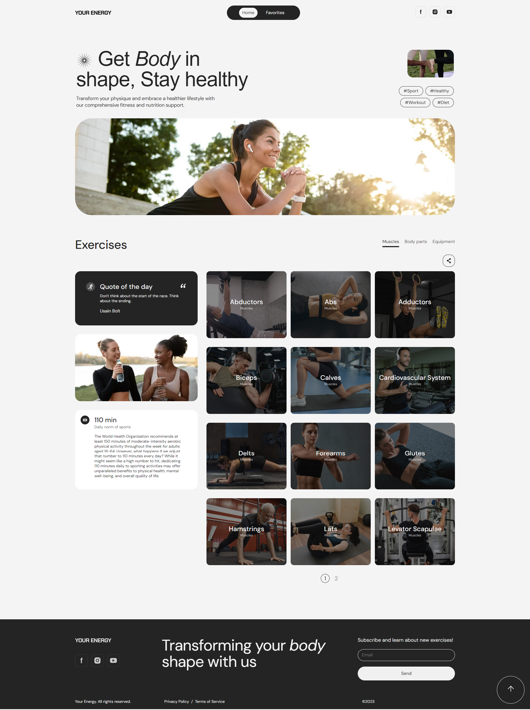

# Your Energy Project

Welcome to the Your Energy Project! This web application allows users to search
for and explore various exercises based on different filters such as body part,
muscles, and equipment. Users can easily find the exercises they need to stay
fit and healthy.

## Presentation

https://oksanadonchuk.github.io/Presentation-your-energy/



## Features

- **Filter Panel**: Use the filter panel to search for exercises by body part,
  muscles, or equipment.
- **Exercise List**: View a comprehensive list of exercises based on the
  selected filters.
- **Responsive Design**: The site is fully responsive and works well on all
  devices.
- **User-Friendly Interface**: Easy-to-navigate interface with clear
  categorization of exercises.

## Technologies Used

- **HTML5**: For the structure of the web pages.
- **CSS3**: For styling the web pages, including responsive design.
- **JavaScript**: For adding interactivity and functionality to the site.
- **React**: For building the user interface.
- **react-hook-form**: For form state management.
- **Yup**: For form validation.

## Project Setup

1. **Clone the repository**:

```
git clone https://github.com/sem-aa/your-energy-project8.git
cd cocktail-bar-site
```

2. **Install dependencies**:

```
npm install
```

3. **Run the application**:

```
npm start
```

4. **Build the application for production**:

```
npm run build
```

## Contributions

Contributions are welcome! If you would like to contribute to this project,
please follow these steps:

1. Fork the repository.
2. Create a new branch: `git checkout -b my-feature-branch`.
3. Make your changes and commit them: `git commit -m 'Add some feature'`.
4. Push to the branch: `git push origin my-feature-branch`.
5. Create a pull request.

## Acknowledgements

- Thanks to the creators of the APIs used in this project. Special thanks to the
- team members who contributed to the development of this site.
